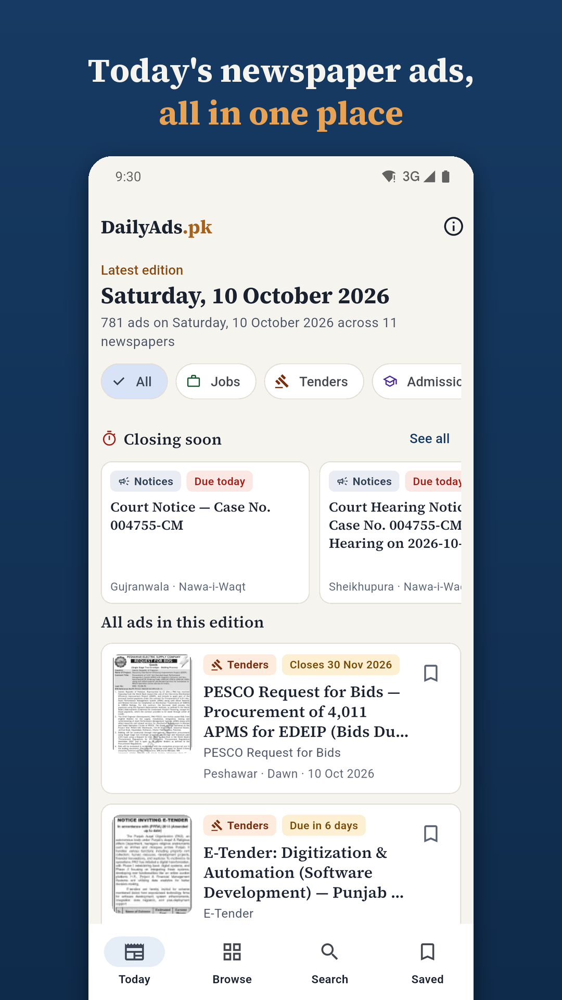
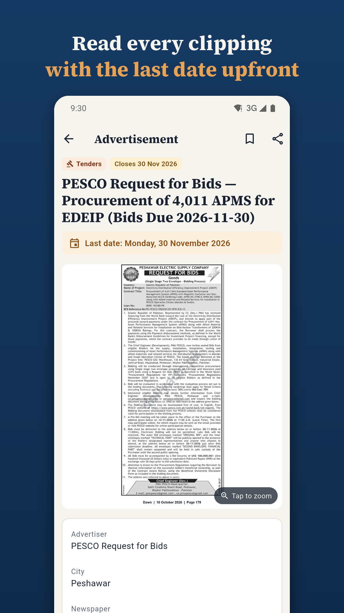
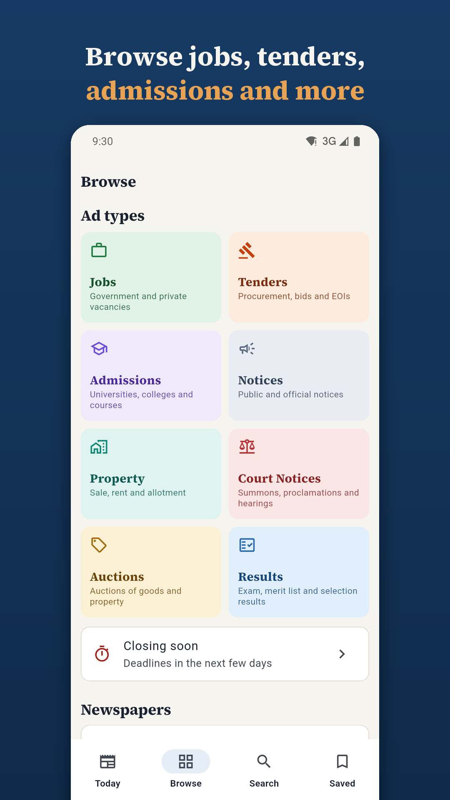
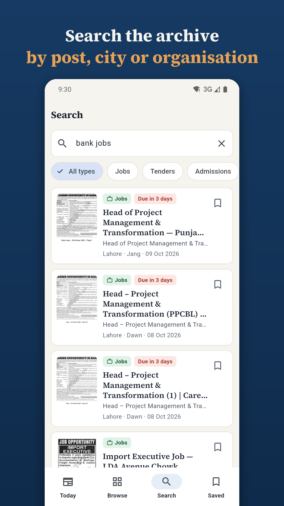

# DailyAds.pk for Android

Jobs, tenders, admissions, notices and results from Pakistan's daily
newspapers, readable on your phone. This is the open-source Android app for
[dailyads.pk](https://dailyads.pk), the archive that collects the
advertisements printed each day in Dawn, Jang, Express, The News,
Nawa-i-Waqt, Dunya, The Nation, The Express Tribune, Daily Aaj, Daily Mashriq,
Daily Kawish and more.

[Get it on Google Play](https://play.google.com/store/apps/details?id=pk.dailyads.app)

| Today | Advertisement | Browse | Search |
|---|---|---|---|
|  |  |  |  |

## Features

- **Today's edition** — every advertisement from the latest papers, filterable
  by type: Jobs, Tenders, Admissions, Notices, Property, Court Notices,
  Auctions and Results.
- **Closing soon** — ads whose last date is near.
- **Search** the whole archive by organisation, post, city or keyword.
- **Browse** by ad type, newspaper or city.
- **Advertisement pages** with the original clipping (pinch to zoom), the last
  date, key facts, the full text and a link to the newspaper's own page.
- **Saved ads** and recent searches, kept on the device.
- **Share** any ad with WhatsApp or any other app.

No account, no ads, no analytics, no tracking. The only network requests go to
dailyads.pk.

## How it works

The app has no API of its own. Every public page on dailyads.pk is also
available as markdown when requested with `Accept: text/markdown` — the same
rendering the site offers to AI agents (see
[dailyads.pk/llms.txt](https://dailyads.pk/llms.txt)). The app fetches those
pages and parses them:

| Path | Purpose |
|---|---|
| `lib/data/site_client.dart` | HTTP client with a short in-memory cache |
| `lib/data/markdown_parser.dart` | Turns listing pages into ad cards and advertisement pages into details |
| `lib/data/saved_store.dart` | Saved ads and recent searches (`shared_preferences`) |
| `lib/screens/` | Today, Browse, Search, Saved, advertisement and About screens |
| `lib/theme.dart` | Colours and type taken from the site's design system |

Listing URLs follow the site: `/date/YYYY-MM-DD`, `/category/<type>`,
`/city/<slug>`, `/newspaper/<slug>`, `/closing-soon` and
`/archive/search/<query>`, each paginated with `?page=N`. Thumbnails use the
site's image proxy, which only serves thumbnails at `&w=320&thumb=1`.

The parser tests run against real pages saved in `test/fixtures/`. If the
site's markdown changes, refresh them:

```sh
H="Accept: text/markdown"
curl -s -H "$H" https://dailyads.pk/category/jobs   -o test/fixtures/category.md
curl -s -H "$H" https://dailyads.pk/closing-soon    -o test/fixtures/closing.md
curl -s -H "$H" https://dailyads.pk/newspaper/dawn  -o test/fixtures/newspaper.md
curl -s -H "$H" https://dailyads.pk/                -o test/fixtures/home.md
flutter test
```

## Building

Requires Flutter (stable channel, 3.47 or later) and the Android SDK.

```sh
flutter pub get
flutter test
flutter run                    # debug build on a device or emulator
flutter build apk --release    # signed with the debug key unless configured
```

To sign a release, create `android/key.properties` (it is git-ignored):

```properties
storeFile=/path/to/upload-keystore.jks
storePassword=...
keyAlias=...
keyPassword=...
```

### Store assets

- `python tool/make_brand_assets.py` draws the launcher icon, the 512 px store
  icon and the 1024×500 feature graphic (needs Pillow).
- `python tool/make_store_screenshots.py` frames the raw captures in
  `store/screenshots/` as 1080×1920 store screenshots.
- `dart run flutter_launcher_icons` regenerates the Android launcher icons.

Store listing text and images live in `fastlane/metadata/android/en-US/`.

## Contributing

Bug reports and pull requests are welcome — see
[CONTRIBUTING.md](CONTRIBUTING.md). To report a wrong or outdated
advertisement, use the [contact page](https://dailyads.pk/contact) on the
site instead.

## Disclaimer

DailyAds.pk is an independent, privately run archive. It is not affiliated
with any government department, advertiser or newspaper, and applications are
never submitted through the app. Always follow the instructions printed in the
original advertisement.

## Licence

The source code is licensed under the
[GNU General Public License v3.0 or later](LICENSE).

The licence covers this code only. Advertisements, clippings and text served
by dailyads.pk belong to their respective advertisers and newspapers. The
DailyAds.pk name and logo identify the official app; if you publish a fork,
please give it your own name and icon. The bundled Source Serif 4 font is
licensed under the [SIL Open Font License](assets/fonts/OFL.txt).
